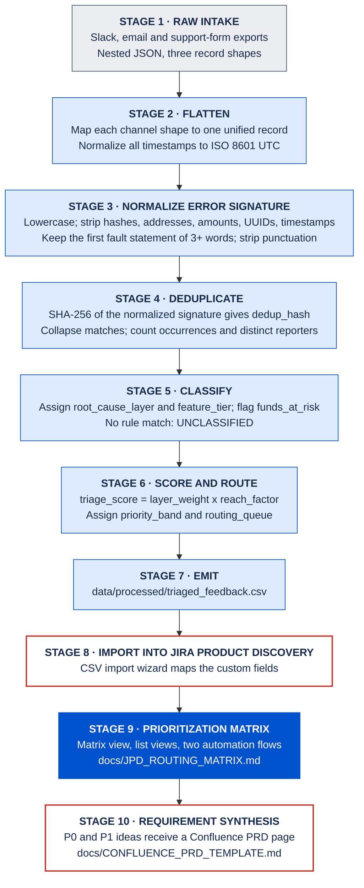
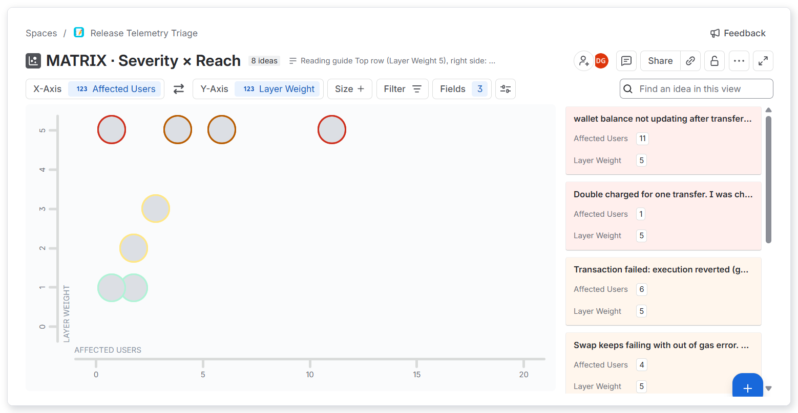
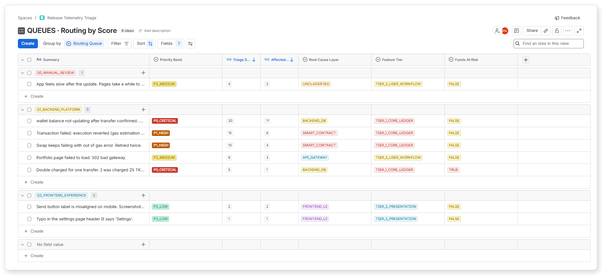
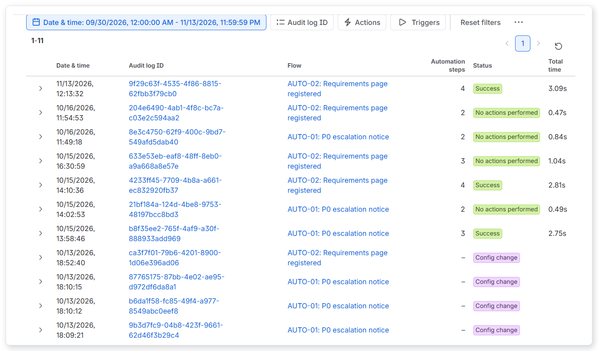
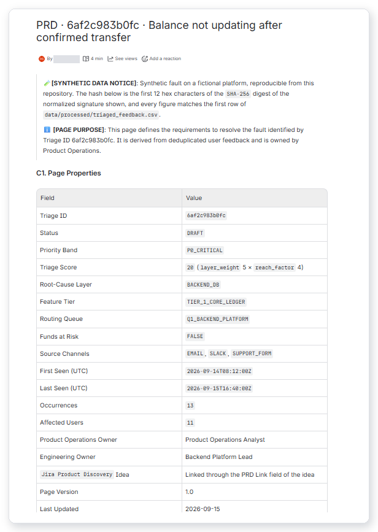
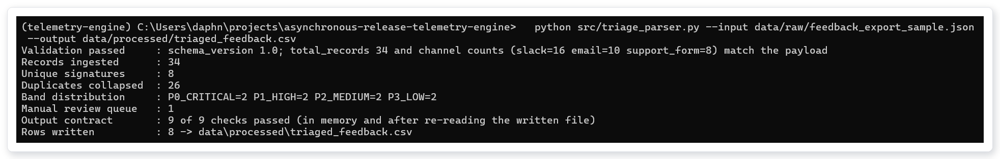

# `asynchronous-release-telemetry-engine`

    

> An automated upstream Product Operations pipeline configured to parse unstructured user feedback anomalies and govern technical developer backlog prioritization metrics asynchronously.

---

> 🧪 **[SYNTHETIC DATA NOTICE]**: Every record in `data/raw/feedback_export_sample.json` is fabricated for demonstration. The platform, users, incident, and error messages do not exist. Nothing in this repository represents a real production system, a real client, or measured business results.

> 🧭 **[SCOPE BOUNDARY]**: This is a systems-architecture and documentation repository. The single `Python` script (`src/triage_parser.py`) is a minimal ingestion vehicle: it flattens, deduplicates, and classifies a static `JSON` export before the data enters `Jira Product Discovery`. It is not an application, a service, or a data-engineering pipeline.

---

## Start Here

| If you want to | Go to |
|:---|:---|
| See the finished build | [10. Evidence Artifacts](#10-evidence-artifacts) |
| Understand the design | [2. The Operational Problem](#2-the-operational-problem), [3. System Architecture](#3-system-architecture), [5. Taxonomy Execution Layer](#5-taxonomy-execution-layer) |
| Read the analysis of the output | [`docs/FINDINGS_AND_RECOMMENDATIONS.md`](docs/FINDINGS_AND_RECOMMENDATIONS.md) |
| Run the parser yourself | [8. Reproduce Locally](#8-reproduce-locally) |
| Rebuild the two workspaces | [9. Workspace Configuration Guides](#9-workspace-configuration-guides) |

**Result at a glance** (from the parser run and the workspace tests in Section 10):

| Measure | Value |
|:---|:---:|
| Feedback records ingested | 34 |
| Unique faults after deduplication | 8 |
| Duplicate reports collapsed | 26 |
| Ideas per band (`P0_CRITICAL` / `P1_HIGH` / `P2_MEDIUM` / `P3_LOW`) | 2 / 2 / 2 / 2 |
| Ideas held for manual review (`Q0_MANUAL_REVIEW`) | 1 |
| Saved views in `Jira Product Discovery` | 4 |
| Automation flows, each tested with one positive and one negative case | 2 |
| `Confluence` requirements pages built (of the 4 `P0_CRITICAL` and `P1_HIGH` ideas that qualify) | 1 |

> ⚠️ **[CONSTRUCTED DISTRIBUTION]**: The 2 / 2 / 2 / 2 band split exists because the author wrote the 34 reports to exercise every band. It is a design check of the pipeline, not a finding about real feedback.

---

## Table of Contents

1. [Executive Summary](#1-executive-summary)
2. [The Operational Problem](#2-the-operational-problem)
3. [System Architecture](#3-system-architecture)
4. [Tool Stack](#4-tool-stack)
5. [Taxonomy Execution Layer](#5-taxonomy-execution-layer)
6. [Data Contract](#6-data-contract)
7. [Repository Structure](#7-repository-structure)
8. [Reproduce Locally](#8-reproduce-locally)
9. [Workspace Configuration Guides](#9-workspace-configuration-guides)
10. [Evidence Artifacts](#10-evidence-artifacts)
11. [Known Limitations and Operational Traps](#11-known-limitations-and-operational-traps)
12. [Competency Map](#12-competency-map)

---

## 1. Executive Summary

After a release, complaints arrive through `Slack`, email, and a support form in three different shapes, and the same fault is reported many times in different words. This repository shows one way to turn that pile into a ranked backlog.

A small `Python` script flattens the exports, collapses duplicate reports, scores each fault by severity and reach, and writes a `CSV`. The `CSV` is imported into `Jira Product Discovery`, where a matrix view and routing queues put the most severe faults first. `Confluence` holds a requirements page for the faults that qualify. `docs/FINDINGS_AND_RECOMMENDATIONS.md` records what the output shows and where the scoring is fragile.

The project is documentation first: the script is the ingestion step, not the product. "Asynchronous" means no live triage meeting is needed, because engineering reads the ranked queue on its own schedule. All data is synthetic.

---

## 2. The Operational Problem

A Web3 platform ships a major smart-contract update. Within hours, transaction-error complaints arrive through `Slack`, email, and a support form, each in a different structure. The same fault is reported many times in different words. Developers spend sprint capacity on visible but low-consequence front-end defects while a backend database fault affecting user balances sits unranked inside the noise.

| Failure Mode | Observable Symptom | Operational Cost |
|:---|:---|:---|
| **Channel fragmentation** | Three feedback sources, three record shapes, no unified view | No single count of how many users hit the same fault |
| **Duplicate inflation** | One fault reported dozens of times in varying phrasing | Report volume is mistaken for severity |
| **Severity inversion** | Cosmetic defects ranked above value-bearing failures | Critical backend faults wait while minor UI items are fixed |
| **Missing requirements** | Raw complaint text handed to developers as-is | Rework: engineers must reverse-engineer the expected behavior |

---

## 3. System Architecture

The architecture is a vertical sequence. Each stage has one owner type: the `Python` script, a platform configuration, or the analyst.



Color key: grey is the source, light blue is the `Python` script, blue is the configured platform, and a red outline marks a manual analyst step.

| Stage | Owner | Automation Level |
|:---|:---|:---|
| 1 | Source systems | Exports are static files in this repository |
| 2 – 7 | `Python` script | Fully automated per run |
| 8 | Analyst | **Manual**: `CSV` import wizard |
| 9 | `Jira Product Discovery` | Configured once; two automation flows react to manual edits (`docs/JPD_ROUTING_MATRIX.md`, Section 8) |
| 10 | Analyst | **Manual**: authored from the template |

> ⚠️ **[OPERATIONAL SYSTEM TRAP]**: "Asynchronous" in this repository means decoupled from live meetings. It does not mean real-time streaming. Ingestion is a `CSV` import step; no API-based ingestion is configured here.

---

## 4. Tool Stack

| Tool | Role in This Repository | Cost Tier | Repository Touchpoint |
|:---|:---|:---|:---|
| `Jira Product Discovery` | Prioritization workspace, matrix view, routing queues, two automation flows | Free plan (3 creators) | `docs/JPD_ROUTING_MATRIX.md` |
| `Confluence` | Requirements wiki for user-story requirement matrices | Free plan (space `Release Telemetry PRDs`, key `RTP`) | `docs/CONFLUENCE_PRD_TEMPLATE.md` |
| `JSON` | Raw, nested feedback export (input format) | n/a | `data/raw/feedback_export_sample.json` |
| `CSV` | Flat triaged output and `Jira Product Discovery` import format | n/a | `data/processed/triaged_feedback.csv` |
| `Python (Light log parsing logic)` | Flatten, normalize, deduplicate, classify, score | Open source | `src/triage_parser.py` |
| `Markdown` | Documentation format for all specifications | n/a | all `.md` files |

**Python dependencies:** none beyond the standard library (`json`, `csv`, `hashlib`, `re`, `argparse`, `datetime`). The input is `JSON`, so no HTML scraping and no HTTP calls are needed. `src/triage_parser.py` is a single file of about 660 lines, including input validation and output checks.

**Authoring environment:**

| Component | Version / Detail |
|:---|:---|
| Editor | `VS Code` |
| Runtime | `Python 3.13` via `Miniconda 3` |
| Version control | `Git` (standalone), repository hosted on `GitHub` |

---

## 5. Taxonomy Execution Layer

### 5.1 Technique: Root-Cause Anomaly Triage

| Capability | Implementation | Evidence Artifact |
|:---|:---|:---|
| Flatten chaotic nested input | Three channel-specific mappings into one unified record | `src/triage_parser.py`, Section 6.1 of this file |
| Isolate the fault from the noise | Signature normalization strips volatile tokens (hashes, addresses, amounts, timestamps), keeps the first fault statement of at least three words, and removes punctuation | `error_signature` column |
| Remove duplicate flags | `SHA-256` digest of the normalized signature, truncated to 12 hex characters | `dedup_hash` column |
| Locate the failing layer | Rule-based assignment to `root_cause_layer` | Section 5.3 |
| Separate severity from volume | `triage_score` combines layer severity with distinct-reporter reach, not raw report count | `triage_score` column |
| Never hide what cannot be classified | Unmatched records go to a manual review queue, not to a low-priority default | `Q0_MANUAL_REVIEW` |

### 5.2 Skill: Requirement Synthesis & Taxonomy Design

| Capability | Implementation | Evidence Artifact |
|:---|:---|:---|
| Design a closed vocabulary | Five root-cause layers, three feature tiers, four priority bands, three routing queues | Section 5.3 |
| Translate complaints into requirements | Raw user text rewritten as user stories with acceptance criteria | `docs/CONFLUENCE_PRD_TEMPLATE.md` |
| Make the taxonomy operable | Every enum maps to a `Jira Product Discovery` field, view, or automation flow | `docs/JPD_ROUTING_MATRIX.md` |
| Keep one source of truth | The tables below define the contract; supporting documents extend it and never override it | This section |

### 5.3 Canonical Taxonomy Reference

> 🔒 **[CANONICAL SPECIFICATION]**: The tables in Sections 5.3 and 6 are the single source of truth. `docs/TAXONOMY_EXECUTION_LAYER.md` adds worked examples and never overrides these values.

**Root-cause layers**

| `root_cause_layer` | `layer_weight` | Definition | Example Signal |
|:---|:---:|:---|:---|
| `SMART_CONTRACT` | 5 | Fault in on-chain execution logic | Transaction reverts, gas estimation failure |
| `BACKEND_DB` | 5 | Ledger, index, or stored-state mismatch | Balance not updating, history records missing |
| `API_GATEWAY` | 3 | Transport, authentication, or availability fault | Timeouts, `502` responses, rate-limit errors |
| `FRONTEND_UI` | 1 | Presentation defect with no data or funds consequence | Misalignment, typo, wrong color |
| `UNCLASSIFIED` | 2 | No classification rule matched | Anything outside the rule set |

**Reach factor** (derived from `affected_users`, the count of distinct reporters after deduplication)

| `affected_users` | `reach_factor` |
|:---:|:---:|
| 1 | 1 |
| 2 – 4 | 2 |
| 5 – 9 | 3 |
| 10 – 24 | 4 |
| 25 or more | 5 |

**Scoring and priority bands**

`triage_score = layer_weight × reach_factor` (range 1 – 25)

| `priority_band` | Rule | Backlog Treatment |
|:---|:---|:---|
| `P0_CRITICAL` | `triage_score` ≥ 20, **or** `funds_at_risk` = `TRUE` | Immediate escalation to the engineering lead queue |
| `P1_HIGH` | `triage_score` 10 – 19 | Candidate for next sprint planning |
| `P2_MEDIUM` | `triage_score` 4 – 9 | Groomed backlog |
| `P3_LOW` | `triage_score` 1 – 3 | Batched or iceboxed |

> ⚠️ **[OPERATIONAL SYSTEM TRAP]**: `funds_at_risk` overrides the score. Without the override, a single-reporter report of a double-charged transaction would score 5 and land in `P2_MEDIUM`. The side effect: queues are sorted by `triage_score`, so that `P0_CRITICAL` idea (`9fef700c305f`, score 5) sorts last in `Q1_BACKEND_PLATFORM`, below a `P2_MEDIUM` idea with score 6. Read the `priority_band` column, not the row position (`docs/JPD_ROUTING_MATRIX.md`, Section 11).

**Routing queues**

| `routing_queue` | Receives |
|:---|:---|
| `Q1_BACKEND_PLATFORM` | `root_cause_layer` in `SMART_CONTRACT`, `BACKEND_DB`, `API_GATEWAY` |
| `Q2_FRONTEND_EXPERIENCE` | `root_cause_layer` = `FRONTEND_UI` |
| `Q0_MANUAL_REVIEW` | `root_cause_layer` = `UNCLASSIFIED` |

**Feature tiers** (a reporting dimension; it does not enter `triage_score`)

| `feature_tier` | Scope |
|:---|:---|
| `TIER_1_CORE_LEDGER` | Value-bearing functions: transfers, staking, balances, settlement |
| `TIER_2_USER_WORKFLOW` | Onboarding, wallet connection, notifications, account settings |
| `TIER_3_PRESENTATION` | Visual layout, copy, themes |

**Illustrative calculation** (hypothetical, to show the formula; not drawn from the sample data):

```
root_cause_layer   = BACKEND_DB            -> layer_weight = 5
affected_users     = 12                    -> reach_factor = 4
triage_score       = 5 x 4 = 20            -> priority_band = P0_CRITICAL
routing_queue      = Q1_BACKEND_PLATFORM
```

---

## 6. Data Contract

### 6.1 Input: `JSON` export

Top-level keys: `export_meta` and `channels`. Each channel has its own record shape:

| Channel | Path | Timestamp Field | Reporter Field | Text Field |
|:---|:---|:---|:---|:---|
| `SLACK` | `channels.slack[]` | `ts` (epoch seconds, string) | `user.id` | `payload.text` |
| `EMAIL` | `channels.email[]` | `received_at` (`ISO 8601`, UTC) | `from.address` | `body.plain` |
| `SUPPORT_FORM` | `channels.support_form[]` | `submitted_at` (`ISO 8601`, with offset) | `reporter.ref` | `fields.description` |

All reporter identifiers in the sample are synthetic.

**Validation.** The parser checks the export before it writes anything, and checks the output after it writes it. Any failure stops the run and names the cause.

| Stage | Check | On Failure |
|:---|:---|:---|
| 1. Envelope | `export_meta.schema_version` is `1.0`; `export_meta.total_records` and every `export_meta.channel_counts` value equal the number of records actually present; the three channel arrays exist and no other channel keys are present | Exit code 2; no output written |
| 2. Records | Every record has a non-empty identifier, timestamp, reporter, and text; timestamps parse (epoch seconds for `SLACK`, `ISO 8601` with an explicit time zone for the other channels); record identifiers are unique; every report yields a usable signature | Exit code 2; all record errors listed together; no output written |
| 3. Output, in memory | The generated rows satisfy the 9-point import contract in `docs/JPD_ROUTING_MATRIX.md` Section 5.1 and the scoring rules in Section 5.3 | Exit code 3; no output written |
| 4. Output, on disk | The written file is re-read: strict `UTF-8`, exact header, no carriage returns, rows identical to those generated | Exit code 3; discard the file |

A missing input file or an unwritable output path exits with code 1.

### 6.2 Output: `CSV` columns (fixed order)

| # | Column | Type | Meaning |
|:---:|:---|:---|:---|
| 1 | `dedup_hash` | string | First 12 hex characters of the `SHA-256` digest of `error_signature` |
| 2 | `error_signature` | string | Normalized fault description used for deduplication |
| 3 | `source_channels` | string | Pipe-delimited channels in which the fault appeared |
| 4 | `first_seen_utc` | datetime | Earliest report, `ISO 8601` UTC |
| 5 | `last_seen_utc` | datetime | Latest report, `ISO 8601` UTC |
| 6 | `occurrence_count` | integer | Total reports collapsed into this row |
| 7 | `affected_users` | integer | Distinct reporters |
| 8 | `root_cause_layer` | enum | Section 5.3 |
| 9 | `feature_tier` | enum | Section 5.3 |
| 10 | `funds_at_risk` | boolean | `TRUE` or `FALSE` |
| 11 | `layer_weight` | integer | Section 5.3 |
| 12 | `reach_factor` | integer | Section 5.3 |
| 13 | `triage_score` | integer | `layer_weight × reach_factor` |
| 14 | `priority_band` | enum | Section 5.3 |
| 15 | `routing_queue` | enum | Section 5.3 |
| 16 | `sample_summary` | string | One representative original report (maps to the `Summary` field in `Jira Product Discovery`) |

---

## 7. Repository Structure

```
asynchronous-release-telemetry-engine/
|-- README.md
|-- LICENSE
|-- .gitattributes
|-- .gitignore
|-- assets/
|   |-- jpd_matrix_view.png
|   |-- jpd_list_view.png
|   |-- jpd_automation_audit.png
|   |-- confluence_prd_page.png
|   `-- parser_run.png
|-- data/
|   |-- raw/
|   |   `-- feedback_export_sample.json
|   `-- processed/
|       `-- triaged_feedback.csv
|-- docs/
|   |-- CONFLUENCE_PRD_TEMPLATE.md
|   |-- FINDINGS_AND_RECOMMENDATIONS.md
|   |-- JPD_ROUTING_MATRIX.md
|   `-- TAXONOMY_EXECUTION_LAYER.md
`-- src/
    `-- triage_parser.py
```

| Path | Purpose |
|:---|:---|
| `LICENSE` | `MIT` licence covering the documentation, the parser, and the synthetic data |
| `.gitattributes` | Forces `LF` line endings and marks screenshots as binary, so the checked-in `CSV` stays byte-identical on every platform |
| `.gitignore` | Keeps local noise out and allow-lists the files in `data/` and `assets/` |
| `docs/CONFLUENCE_PRD_TEMPLATE.md` | Structured product requirements page for P0 and P1 items |
| `docs/JPD_ROUTING_MATRIX.md` | Exact field, view, and automation configuration for the routing dashboard, with the behavior observed while building it |
| `docs/TAXONOMY_EXECUTION_LAYER.md` | Worked triage examples for the technique and the skill |
| `docs/FINDINGS_AND_RECOMMENDATIONS.md` | Findings computed from the output: where report volume fails, how sensitive the bands are, and what to change before real use |
| `data/raw/` | Synthetic input |
| `data/processed/` | Parser output and `Jira Product Discovery` import file |
| `src/` | The only executable file |
| `assets/` | Screenshots of the configured workspaces |

---

## 8. Reproduce Locally

Requirements: `Python 3.13`. No `pip install` step is needed.

**Step 1.** Download or clone this repository and open a terminal in its root folder.

**Step 2.** Create an isolated environment (optional but recommended) in `Anaconda Prompt`:

```
conda create -n telemetry-engine python=3.13 -y
conda activate telemetry-engine
python --version
```

**Step 3.** Run the parser from the repository root:

```
python src/triage_parser.py --input data/raw/feedback_export_sample.json --output data/processed/triaged_feedback.csv
```

Running `python src/triage_parser.py` with no arguments uses the same two paths as defaults.

**Step 4.** Confirm the output: `data/processed/triaged_feedback.csv` exists, has the 16 columns listed in Section 6.2, and the console summary reads exactly as follows (on Windows the last line prints the path with backslashes):

```
Validation passed     : schema_version 1.0; total_records 34 and channel counts (slack=16 email=10 support_form=8) match the payload
Records ingested      : 34
Unique signatures     : 8
Duplicates collapsed  : 26
Band distribution     : P0_CRITICAL=2 P1_HIGH=2 P2_MEDIUM=2 P3_LOW=2
Manual review queue   : 1
Output contract       : 9 of 9 checks passed (in memory and after re-reading the written file)
Rows written          : 8 -> data/processed/triaged_feedback.csv
```

The run is deterministic: re-running it on the sample reproduces the committed `CSV` byte for byte. A screenshot of the run is in Section 10.

**Step 5.** Continue in the platforms using the guides in Section 9.

---

## 9. Workspace Configuration Guides

| Order | Platform | Task | Guide |
|:---:|:---|:---|:---|
| 1 | `Jira Product Discovery` | Create fields, import the `CSV`, build the four saved views, add and test two automation flows | `docs/JPD_ROUTING_MATRIX.md` |
| 2 | `Confluence` | Create the requirements page for each `P0_CRITICAL` and `P1_HIGH` idea | `docs/CONFLUENCE_PRD_TEMPLATE.md` |
| 3 | Either | Walk through worked triage examples | `docs/TAXONOMY_EXECUTION_LAYER.md` |
| 4 | Either | Read the findings and the design critique | `docs/FINDINGS_AND_RECOMMENDATIONS.md` |

---

## 10. Evidence Artifacts

The configured workspaces sit behind a login, so the screenshots below are the public proof of the build. Click any image to open it at full size.

| Artifact | File | Shows |
|:---|:---|:---|
| Prioritization matrix | `assets/jpd_matrix_view.png` | `VIEW-01`: the 8 imported ideas plotted by `Affected Users` and `Layer Weight`, cards colored by `Priority Band` |
| Routing list | `assets/jpd_list_view.png` | `VIEW-02`: ideas grouped by `Routing Queue` and sorted by `Triage Score` |
| Automation history | `assets/jpd_automation_audit.png` | Runs of `AUTO-01` and `AUTO-02` with outcome and step count |
| Requirements page | `assets/confluence_prd_page.png` | The top of the `Confluence` requirements page for Triage ID `6af2c983b0fc` |
| Parser run | `assets/parser_run.png` | Terminal output of Step 3 in Section 8 |

### 10.1 Prioritization matrix

[](assets/jpd_matrix_view.png)

*`VIEW-01` in `Jira Product Discovery`. Horizontal axis: `Affected Users`; vertical axis: `Layer Weight`. Red and orange cards are `P0_CRITICAL` and `P1_HIGH`; yellow and green are `P2_MEDIUM` and `P3_LOW`.*

> ⚠️ **[OPERATIONAL SYSTEM TRAP]**: The matrix plots two raw fields. It does not draw band thresholds and does not show the `funds_at_risk` override, so read the band from the card color or from `VIEW-02`.

### 10.2 Routing list

[](assets/jpd_list_view.png)

*`VIEW-02`: `Q1_BACKEND_PLATFORM`, `Q2_FRONTEND_EXPERIENCE`, and `Q0_MANUAL_REVIEW`, each sorted by `Triage Score` descending. The `P0_CRITICAL` idea with score 5 sits at the bottom of `Q1_BACKEND_PLATFORM` because of the `funds_at_risk` override (Section 5.3).*

### 10.3 Automation history

[](assets/jpd_automation_audit.png)

*The audit log of the space: configuration changes and the runs of `AUTO-01` and `AUTO-02`. Each flow was tested with one positive case (outcome Success) and one negative case (outcome No actions performed). The **Automation steps** column shows that a step is one executed component: trigger, each condition evaluated, and the action (`docs/JPD_ROUTING_MATRIX.md`, Section 8). Seven runs are visible in total: the four tests, plus three later runs (two No actions performed, made while restoring the test ideas, and one Success from registering the real requirements page for `6af2c983b0fc`).*

### 10.4 Requirements page

[](assets/confluence_prd_page.png)

*The requirements page `PRD · 6af2c983b0fc · Balance not updating after confirmed transfer`: the title, the two opening notices, and the first rows of Section C1 (Page Properties). The full page has 13 sections, reproduced as Part C of `docs/CONFLUENCE_PRD_TEMPLATE.md`.*

### 10.5 Parser run

[](assets/parser_run.png)

*The command from Section 8, Step 3, and its console summary, run on `Python 3.13`.*

---

## 11. Known Limitations and Operational Traps

> ⚠️ **[CLASSIFIER LIMITATION]**: Classification is rule-based keyword matching. Precision and recall have not been measured against real data. Records that match no rule are routed to `Q0_MANUAL_REVIEW` rather than defaulted to a low priority.

> ⚠️ **[DEDUPLICATION BOUNDARY]**: Deduplication is exact-match on the normalized signature. Two reports describing the same fault in different words will not merge. The `dedup_hash` is truncated to 12 hex characters (48 bits); collision risk is negligible at this volume but is not zero.

> ⚠️ **[AUTOMATION USAGE TRAP]**: The `Jira Product Discovery` usage screen counts runs, steps, and credits, and labels them as estimates. A run that ends in No actions performed still counts, and the author could not confirm a monthly limit on screen, so none is claimed. Field values arrive through the `CSV` import, not through automation, so no flow fires on idea creation (`docs/JPD_ROUTING_MATRIX.md`, Section 8).

> ⚠️ **[CIRCULARITY LIMITATION]**: The sample reports, the classification phrases, and the weights share one author, so the results show the pipeline is consistent, not that it is accurate (`docs/TAXONOMY_EXECUTION_LAYER.md`).

> ⚠️ **[TIME-BLINDNESS LIMITATION]**: The score reads a running total of distinct reporters. It ignores how fast a fault is growing and whether it has stopped. In the sample, the most reported fault took 20 hours 38 minutes to reach `P0_CRITICAL` (`docs/FINDINGS_AND_RECOMMENDATIONS.md`, Section 6).

> ⚠️ **[PRIVATE WORKSPACE]**: The `Jira Product Discovery` space and the `Confluence` space are not publicly accessible. Section 10 shows what they contain; a reader cannot open them.

> ⚠️ **[IMPORT DUPLICATION TRAP]**: The `Jira Product Discovery` `CSV` import creates ideas; this repository assumes it does not update existing ones by `dedup_hash`. Import each export once, into an empty space. A second import into a populated space can create duplicate ideas. If a trial import fails its checks, delete every imported idea before importing again (`docs/JPD_ROUTING_MATRIX.md`, Section 5.3).

> ⚠️ **[CREATOR LIMIT TRAP]**: The Free plan supports 3 creators. Adding a fourth moves the site onto a Standard plan trial.

> ⚠️ **[PRIVACY BOUNDARY]**: Real feedback exports contain personal data. This repository contains none. Any real deployment must redact or hash reporter identifiers before import.

---

## 12. Competency Map

| Competency | Where Demonstrated |
|:---|:---|
| Backlog governance | Scoring model, priority bands, routing queues |
| Root-cause analysis | Layer classification and signature deduplication |
| Taxonomy design | Closed enums with a single canonical specification |
| Requirements documentation | `Confluence` requirements template with user stories and acceptance criteria |
| Process design | Staged architecture with explicit owners and automation levels |
| Workflow automation | Two `Jira Product Discovery` flows, each tested with a positive and a negative case, with the audit log as evidence |
| Data hygiene | Timestamp normalization, deduplication, privacy boundary |
